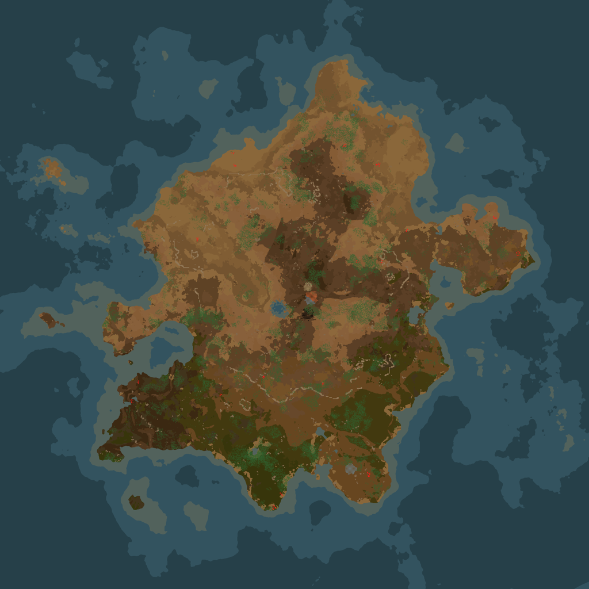

# Freight Forwarding 2.0.0 — перенос на Factorio 2.1

Исходник: FreightForwarding 1.9.0 (Factorio 1.1), см. первый коммит. Мод лежит в `FreightForwarding/`.

## Что изменено

### Генерация мира (переписана полностью)
В 2.x noise-выражения — это **строки**, библиотеки `require "noise"` больше нет. Формулы остались те же, что в 1.x.

| Что | Файл | Как сделано в 2.x |
|---|---|---|
| Рельеф-острова `x-continents` | `prototypes/map-gen.lua` | Та же математика (IslandStart + правки FF): большой стартовый остров (~650–700 тайлов), пустой океан до ~850, дальше архипелаги. Октавы шума с переменной persistence собраны в `local_expressions`. |
| Переменные 1.1, которых больше нет | там же | `water_level`/`wlc_*` → `ff_water_level = 10·log2(control:water:size)`; стартовое озеро — `ff_starting_lake_elevation` через `distance_from_nearest_point` + `starting_lake_positions`. |
| Тайлы воды | `prototypes/water.lua`, `map-gen.lua` | `ff_water_autoplace(max_elevation, influence)` повторяет 1.1 `make_water_autoplace_settings`: мелководье (0, 25), вода (−2.5, 100), глубокая вода (−8, 200). |
| Ресурсы | `resource-autoplace/*`, `prototypes/resources.lua` | Свой resource-autoplace переписан на строки (`spot_noise`, `basis_noise`, `random_penalty`). Сохранены все особенности FF: «кольцо» свинца/железа у края стартового острова, `ideal_aux` через `ff_resource_spread`, отложенное появление урана/титана (>1800), лава-бассейны (>3000), подводные горы (высота < −20), кратеры для ракетных шахт (высота > 8, > 4000 тайлов). Наборы пятен (patch sets) общие с ванильным модулем, чтобы руды не перекрывались. |
| Враги дальше от старта | `prototypes/autoplace-updates.lua` | `distance` и `starting_area_radius` в выражениях врагов Нувиса заменяются на `/2.5` (строковой заменой; именованные аргументы не трогаются). Враги Глебы не затрагиваются. |
| Пресет карты | `prototypes/map-gen-presets.lua` | `terrain_segmentation`/`water` → контрол `water` (масштаб/покрытие). Убран `research_queue_setting`. Скалы идут по рельефу FF (`cliff_elevation = ff_cliff_elevation`). Пресет «ribbon world» удалён (в 1.9 он и так был скрыт). |
| Планета Нувис | `prototypes/planet-nauvis.lua`, `map-gen-presets.lua` | В 2.x генерация задаётся `planet.map_gen_settings`. Ресурсы/контролы FF и мелководье добавлены в списки Нувиса (только если списки там есть). Новая стартовая настройка **«Острова по умолчанию»** (вкл.) — острова FF даже с пресетом «По умолчанию» и в Space Age. |

### Прототипы
* `prototypes/legacy.lua` — конвертер формата 1.1 → 2.x, через него идут все `data:extend` мода: рецепты (`{"item", n}` → `{type, name, amount}`, `result`/`result_count`, `catalyst_amount`), флаг `"hidden"` → `hidden = true`, `hr_version` → HD-спрайт (и пути `__base__/…/hr-*.png` без префикса), `emissions_per_minute = {pollution = …}`, `fuel_category` → `fuel_categories`, fluid box (`base_area` → `volume`, подключения труб с `direction`), `graphics_set` у машин, маски коллизий, `rocket_launch_products`.
* `prototypes/collision-util.lua` — слои коллизий теперь прототипы `collision-layer`: `ff_non_deep_water`, `ff_deep_water`, `ff_platform`, `ff_water_object`, `ff_substitute_player`, `ff_underwater_pipe`, `ff_lava_pool`, `ff_lava_pool_water_tile`.
* `prototypes/data-util.lua` — свои функции для рецептов/технологий (вместо внутренностей `__bzlead__.data-util`); все безопасны: если чего-то нет, пишут в лог и не падают.
* Переименования 2.x: `stack-inserter` → `bulk-inserter`, `effectivity-module-3` → `efficiency-module-3`, `empty-barrel` → `barrel`, `advanced-electronics-2` → `processing-unit`, удалены красный/зелёный провод и **блок управления ракетой** (вместо +1 заряженной батареи на блок → +5 заряженных батарей на часть ракеты; без Space Age).
* Радары FF (сейсмосканер, сонар-буй, радар земснаряда) — `connects_to_other_radars = false` (в 2.x радары по умолчанию объединяются).
* Mini Trains, Spidertron Patrols, Lex's Aircraft, Hovercrafts, Canal Builder, Beautiful Bridge Railway стали **необязательными**: код интеграции срабатывает только если мод есть.
* Анимации главного меню FF отключены: это сохранения 1.1, их нужно перезаписать в 2.x.

### Скрипты (control)
`global` → `storage`; `event.created_entity` → `event.entity`; `on_entity_destroyed` → `on_object_destroyed` (`useful_id`); `rendering` возвращает `LuaRenderObject` (старые id из сохранений 1.1 конвертируются); логистические запросы через `LuaLogisticSection`; `get_contents()` — массив; `spill_item_stack{…}`; `entity.active` → `disabled_by_script`; `game.*_prototypes` → `prototypes.*`; статистика производства — по поверхностям; финал (коммуникатор) проверяется в `on_rocket_launch_ordered`, т.к. груз уходит в капсулу.

### Space Age (если включён)
* Нувис — острова FF, остальные планеты не меняются (враги/руды других планет не трогаются, нефть Аквилона не ограничивается).
* Ракетная шахта: на Нувисе — только в кратере (проверка скриптом, шахта возвращается игроку), на других планетах — где угодно.
* Отключены: спутник/космическая наука из ракет, коммуникатор-финал (у SA своя победа), +5 батарей на часть ракеты.
* Транспортная наука принимается всеми лабораториями, которые принимают логистическую (в т.ч. биолабораторией).

## Как проверено

### В настоящем Factorio 2.1.24 (сервер для проверок)
Сторонние моды на этом этапе не скачивались, поэтому запускалась сборка мода без частей, которым они нужны
(предметы BZ заменены заглушками). В неё вошли: генерация мира, вода/насыпь/лава, земснаряд, конкреции,
кобальт, батареи и станции зарядки, сейсмосканер, сонар-буй, подводная труба, морской бак, поезда,
транспортная наука, ракетная шахта, советы, `data-final-fixes` (все слои коллизий) и все скрипты.

* Загрузка прототипов — **без ошибок**, с Space Age и без.
* `--create` (создание карты, `on_init` всех скриптов) — **без ошибок**. Встроенный тест коллизий: 57 из 66;
  оставшиеся 9 — то, что делает Cargo Ships (насосы на воде, слой ресурсов с воды), плюс намеренно
  неограниченная нефть в Space Age.
* `--generate-map-preview` на всех планетах Space Age — без ошибок. Нувис — острова FF, остальные планеты не тронуты.
* Карта 8192×8192, сид 12345 (`docs/map-preview-8192.png`): лава-бассейнов 198, кратеров для шахт 9, урановые
  месторождения есть, нефть 868 месторождений только на глубокой воде, подводных гор 28 (с эмуляцией Cargo Ships).

Что нашла настоящая игра (моя проверка на заглушках этого не видела) и что исправлено:
* **2.1:** у рецептов `category` → `categories`; у предметов `fuel_category` → `fuel_categories`;
  у продуктов `probability` → `independent_probability`. Всё добавлено в конвертер `legacy.lua`.
* частица `deep-water-particle` удалена → `tintable-water-particle`;
* `settings.lua` падал без других модов;
* заглушка ракетной шахты: копия шахты 2.1 тянула несовместимые поля — теперь собирается с нуля;
* земснаряд: размеры спрайтов насоса в 2.x другие — теперь графика берётся из прототипа насоса.

### Вне игры
* Синтаксис всех `.lua` — `luac5.2 -p`.
* `tools/mock-data-stage/`: прогон data-стадии на заглушках и разбор всех noise-выражений.

## Что ещё НЕ проверено
1. **Мод целиком со всеми зависимостями.** Версии под 2.1 есть у Cargo Ships, BZ Lead, BZ Titanium, Mini Trains,
   Spidertron Patrols, Lex's Aircraft, Hovercrafts. **Intermodal Containers и Canal Builder есть только под 2.0**,
   Beautiful Bridge Railway — только под 1.1 (он необязательный). Имена прототипов этих модов
   (`water_transport`, `tank_ship`, `oil_rig`, `ic-containerization-*`, `hcraft-*`…) взяты из 1.1: где имени нет,
   интеграция пропускается с записью `[FreightForwarding]` в логе.
2. Игровой процесс: земснаряд, сонар, ракетная шахта в кратере, плавание, ограничения контейнеров.
3. Графика (сервер для проверок не загружает картинки и звуки).
4. Перенос сохранений 1.1 → 2.1.

## Чек-лист первого запуска
- [ ] Игра загружается до главного меню (без SA и с SA).
- [ ] В логе нет ошибок, просмотреть строки `[FreightForwarding] … not found`.
- [ ] Новая карта с пресетом «Freight Forwarding»: остров, свинец на краю, нефть в океане.
- [ ] Земснаряд ставится на подводную гору и строит платформу.
- [ ] Сонар-буй работает на нефти, сейсмосканер не работает у воды.
- [ ] Ракетная шахта ставится только в кратер (на Нувисе).
- [ ] Игрок плавает в воде (спасательный круг), машины в воду не заезжают.
